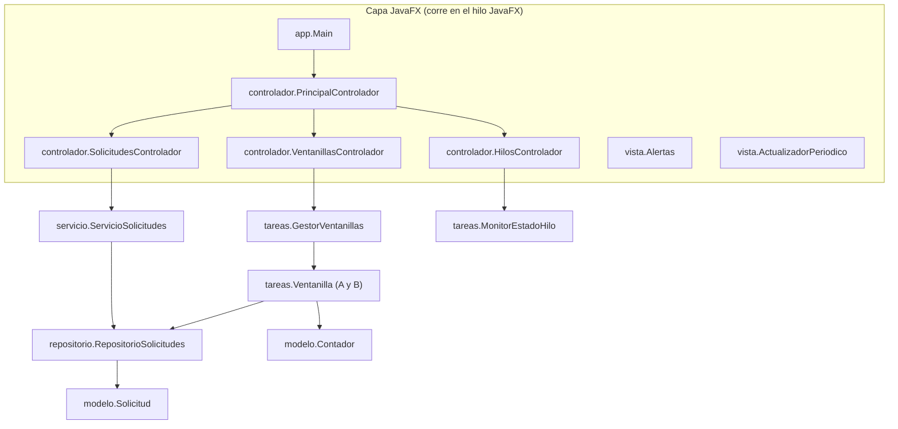
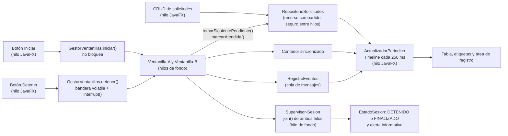

# Laboratorio guiado: Concurrencia en Java y JavaFX

Asignatura: Programación de aplicaciones de escritorio · Modalidad: laboratorio · Equipos de 4 integrantes

Aplicación JavaFX modular que gestiona **solicitudes de una oficina mediante un CRUD** (crear, leer, actualizar, eliminar). Dos **ventanillas** (hilos de fondo) atienden las solicitudes pendientes, actualizan un **contador compartido** sin perder operaciones y pueden **detenerse de forma cooperativa**, sin bloquear nunca la interfaz gráfica. Los avisos al usuario (validaciones, confirmaciones, resultados y errores) se muestran con **`Alert` de JavaFX**.

**Indicador de logro (IL3.3):** gestiona el ciclo de vida y la detención controlada de los hilos durante la ejecución de la aplicación.

> Regla del laboratorio: primero se predice, después se ejecuta, se observa y se explica. Una captura del código sin evidencia de comportamiento no es una evidencia válida.

---

## Tabla de contenido

1. [Equipo](#1-equipo)
2. [Requisitos y ejecución](#2-requisitos-y-ejecución)
3. [Arquitectura modular](#3-arquitectura-modular)
4. [Flujo de la aplicación e hilos](#4-flujo-de-la-aplicación-e-hilos)
5. [Estructura del proyecto](#5-estructura-del-proyecto)
6. [Contrato de clases, paquetes y métodos](#6-contrato-de-clases-paquetes-y-métodos)
7. [Responsables por archivo](#7-responsables-por-archivo)
8. [Organización con GitHub](#8-organización-con-github)
9. [Convención de commits](#9-convención-de-commits)
10. [Procedimiento ante un conflicto de Git](#10-procedimiento-ante-un-conflicto-de-git)
11. [Pruebas y evidencias](#11-pruebas-y-evidencias)
12. [Retos de análisis colaborativo](#12-retos-de-análisis-colaborativo)
13. [Entrega y checklist](#13-entrega-y-checklist)

---

## 1. Equipo

| # | Nombre completo | Usuario de GitHub | Rol | Rama | Responsabilidad |
|---|-----------------|-------------------|-----|------|-----------------|
| 1 | Caleb Tardencilla | CTardencilla | Integrante | `feature/integrante-1` | Estación 1 (Thread y Runnable) y módulo CRUD de solicitudes (servicio y pantalla) |
| 2 | _[completar]_ | _[completar]_ | _[Líder / Integrante]_ | `feature/integrante-2` | Estación 2 (estados de hilos), módulo de monitoreo de hilos y alertas |
| 3 | _Steven Cuadra_ | _LitSoloSteven_ | _Integrante_ | `feature/Steven` | Estación 3 (sincronización): contadores y repositorio concurrente |
| 4 | Alfredo Montalván | wetalff | Líder | `feature/integrante-4` | Estaciones 4 y 5: detención controlada, ventanillas e integración JavaFX |

El **líder** (uno de los cuatro, marcar en la tabla) coordina tareas, verifica que el proyecto compile, revisa los Pull Requests, resuelve conflictos y es **la única persona autorizada para integrar cambios en `main`**. El liderazgo no exime de programar ni de aportar commits.

---

## 2. Requisitos y ejecución

| Elemento | Valor |
|----------|-------|
| JDK | 17 o superior |
| Versión de Java usada por el equipo | _[completar con la salida de `java -version`]_ |
| Gestor de construcción | Maven (proyecto abierto en IntelliJ IDEA) |
| JavaFX | OpenJFX como dependencia Maven (`javafx-controls`, `javafx-fxml`), versión _[completar, p. ej. 21.x]_ |
| Clase principal | `app.Main` |

### Cómo se ejecuta JavaFX en este proyecto

JavaFX no se instala como SDK aparte. Se declara como dependencia de Maven y el plugin `javafx-maven-plugin` coloca los módulos de JavaFX en el *module path* al ejecutar. Por eso la aplicación se lanza con Maven y no con un `java -jar` directo. Fragmento relevante del `pom.xml` (lo mantiene solo el líder):

```xml
<dependencies>
  <dependency>
    <groupId>org.openjfx</groupId>
    <artifactId>javafx-controls</artifactId>
    <version>${javafx.version}</version>
  </dependency>
  <dependency>
    <groupId>org.openjfx</groupId>
    <artifactId>javafx-fxml</artifactId>
    <version>${javafx.version}</version>
  </dependency>
</dependencies>

<plugin>
  <groupId>org.openjfx</groupId>
  <artifactId>javafx-maven-plugin</artifactId>
  <version>0.0.8</version>
  <configuration>
    <mainClass>app.Main</mainClass>
  </configuration>
</plugin>
```

### Comandos

```bash
# Clonar
git clone <URL-DEL-REPOSITORIO>
cd <carpeta-del-repositorio>

# Compilar
mvn clean compile

# Ejecutar la aplicación JavaFX
mvn clean javafx:run

# Ejecutar pruebas unitarias (si el equipo las agrega)
mvn test
```

Las demostraciones por consola de cada estación se ejecutan desde IntelliJ (clic derecho en la clase, *Run*) o con:

```bash
mvn compile exec:java -Dexec.mainClass=demo.DemoThreadRunnable
mvn compile exec:java -Dexec.mainClass=demo.DemoEstadosHilo
mvn compile exec:java -Dexec.mainClass=demo.DemoCondicionCarrera
mvn compile exec:java -Dexec.mainClass=demo.DemoRepositorioConcurrente
```

---

## 3. Arquitectura modular

La aplicación se divide en **capas** (paquetes) con una sola responsabilidad cada una y en **módulos de pantalla** (un FXML y un controlador por módulo). Las capas se conectan por interfaces, y los controladores reciben sus dependencias mediante un objeto `ContextoApp` (inyección manual), sin crear servicios por su cuenta.



### Capas y reglas de dependencia

| Capa (paquete) | Responsabilidad | Puede usar `javafx.*` | Depende de |
|----------------|-----------------|-----------------------|------------|
| `modelo` | Datos puros: `Solicitud`, enums, contadores | No | nada |
| `repositorio` | Almacenamiento del CRUD, seguro entre hilos | No | `modelo` |
| `servicio` | Reglas de negocio y validaciones del CRUD | No | `modelo`, `repositorio` |
| `tareas` | Hilos y `Runnable`: ventanillas, gestor, monitor | No | `modelo`, `repositorio`, `util` |
| `util` | Utilidades transversales sin interfaz gráfica | No | nada |
| `vista` | Ayudas de JavaFX: alertas y actualización periódica | Sí | nada |
| `controlador` | Un controlador por módulo de pantalla | Sí | `servicio`, `tareas`, `vista`, `util`, `modelo` |
| `app` | Arranque y cableado (`Main`, `ContextoApp`) | Sí | todas |
| `demo` | Demostraciones por consola de cada estación | No | `modelo`, `tareas`, `repositorio`, `util` |

Reglas:

1. Las flechas solo van hacia abajo: una capa nunca importa de una capa que la usa. Por ejemplo, `modelo` no conoce a `servicio`, y `tareas` no conoce a `controlador`.
2. **Solo `vista`, `controlador` y `app` importan `javafx.*`.** Toda la lógica de hilos y datos es independiente de la interfaz.
3. **Solo `vista` y `controlador` crean `Alert`.** Las clases de `tareas` jamás muestran alertas: notifican por callbacks o por `RegistroEventos` y el controlador decide qué mostrar.
4. Los controladores no se llaman entre sí. Se comunican por los servicios de `ContextoApp` y por los oyentes del gestor.
5. Prohibido `Thread.stop()` y `System.exit()` para detener las ventanillas. Nunca se ignora una `InterruptedException`: se restaura la bandera con `Thread.currentThread().interrupt()` y se sale.

---

## 4. Flujo de la aplicación e hilos



| Operación | Hilo donde corre |
|-----------|------------------|
| Operaciones del CRUD (crear, listar, actualizar, eliminar), clics, lectura de controles | JavaFX Application Thread |
| Crear y arrancar hilos (`start()`), solicitar detención | JavaFX Application Thread (no bloquea) |
| `Thread.sleep()`, tomar y atender solicitudes, `incrementar()` | `Ventanilla-A`, `Ventanilla-B` |
| `join()` sobre las ventanillas | `Supervisor-Sesion` (**nunca** el hilo JavaFX) |
| Consultar `getState()` periódicamente | `Monitor-*` (hilo de fondo) |
| Modificar tabla, etiquetas, botones y áreas de texto | JavaFX Application Thread (`Platform.runLater` o `ActualizadorPeriodico`) |
| Mostrar un `Alert` | JavaFX Application Thread (`Alertas` hace el `runLater` por quien lo llama) |

**Por qué hay concurrencia real en el CRUD:** el usuario puede crear, editar o eliminar solicitudes mientras las ventanillas las toman. Por eso `RepositorioSolicitudes` ofrece operaciones atómicas (`tomarSiguientePendiente`, `actualizar`, `eliminar`) y el modelo `Solicitud` es **inmutable**: una vez publicada una instancia, ningún hilo puede alterarla, solo se reemplaza por otra.

---

## 5. Estructura del proyecto

```
.
├── pom.xml                                   (líder)
├── README.md                                 (líder)
├── .gitignore                                (líder)
├── docs/
│   ├── estacion-1-thread-runnable.md         (integrante 1)
│   ├── estacion-2-estados-hilo.md            (integrante 2)
│   ├── estacion-3-sincronizacion.md          (integrante 3)
│   ├── estacion-4-5-detencion-integracion.md (integrante 4)
│   ├── informe-final.md                      (líder, máx. 1 página)
│   └── capturas/                             (cada quien con su prefijo: i1-, i2-, i3-, i4-)
└── src/
    ├── main/
    │   ├── java/
    │   │   ├── app/          Main, ContextoApp
    │   │   ├── controlador/  PrincipalControlador, SolicitudesControlador, VentanillasControlador, HilosControlador
    │   │   ├── vista/        Alertas, ActualizadorPeriodico
    │   │   ├── servicio/     ServicioSolicitudes, ReglaNegocioException
    │   │   ├── repositorio/  RepositorioSolicitudes, RepositorioSolicitudesMemoria, ResultadoOperacion
    │   │   ├── tareas/       ProcesoVentanilla, TareaIncremento, MonitorEstadoHilo, Ventanilla, GestorVentanillas
    │   │   ├── modelo/       Solicitud, Prioridad, EstadoSolicitud, EstadoSesion,
    │   │   │                 Contador, ContadorInseguro, ContadorCompartido, ContadorAtomico
    │   │   ├── util/         RegistroEventos
    │   │   └── demo/         DemoThreadRunnable, DemoEstadosHilo, DemoCondicionCarrera, DemoRepositorioConcurrente
    │   └── resources/
    │       └── vista/        principal.fxml, solicitudes.fxml, ventanillas.fxml, hilos.fxml
    └── test/
        └── java/             (opcional, espejo de los paquetes anteriores)
```

---

## 6. Contrato de clases, paquetes y métodos

Esta sección es el **acuerdo de integración**. Los nombres de paquetes, clases, constantes, firmas de métodos e identificadores `fx:id` que aparecen aquí **no se cambian** sin avisar al líder y actualizar este README mediante Pull Request. Cada integrante puede añadir métodos privados o auxiliares, pero no modificar ni renombrar lo declarado.

Lo que se declara son **firmas** (sin cuerpo). Los comentarios indican responsable y comportamiento esperado.

### 6.1 Paquete `modelo`

Tipos de contrato (enums, record, interfaz): los escribe **completos el líder** en el esqueleto inicial y nadie los modifica.

```java
package modelo;

/** Inmutable: es seguro compartir una instancia entre hilos. Los cambios producen una instancia nueva. */
public record Solicitud(int id, String solicitante, String asunto, Prioridad prioridad,
                        EstadoSolicitud estado, String atendidaPor, LocalDateTime creadaEn) {
    public static Solicitud nueva(String solicitante, String asunto, Prioridad prioridad);
        // id = 0, estado PENDIENTE, atendidaPor = null, creadaEn = ahora
    public Solicitud conId(int id);
    public Solicitud conDatos(String solicitante, String asunto, Prioridad prioridad);
    public Solicitud conEstado(EstadoSolicitud estado, String atendidaPor);
}

public enum Prioridad {
    BAJA("Baja"), MEDIA("Media"), ALTA("Alta");
    public String getEtiqueta();
}

public enum EstadoSolicitud {
    PENDIENTE("Pendiente"), EN_PROCESO("En proceso"), ATENDIDA("Atendida");
    public String getEtiqueta();
}

public enum EstadoSesion {
    EN_ESPERA("En espera"),
    EJECUTANDO("Ejecutando"),
    DETENIENDO("Deteniendo"),
    DETENIDO("Detenido"),      // los hilos terminaron porque el usuario pidió detener
    FINALIZADO("Finalizado");  // los hilos terminaron solos: no quedan solicitudes pendientes
    public String getEtiqueta();
}

public interface Contador {
    void incrementar();
    int getTotal();
    void reiniciar();          // vuelve el total a 0 (nueva sesión)
}
```

> Nota: un `record` expone `id()`, `asunto()`, etc., no `getId()`. Por eso las columnas del `TableView` se arman con lambdas (`c -> new ReadOnlyObjectWrapper<>(c.getValue().asunto())`) y no con `PropertyValueFactory`.

Implementaciones de los contadores. **Responsable: integrante 3.**

```java
package modelo;

/** SIN protección. Existe solo para evidenciar la condición de carrera. */
public class ContadorInseguro implements Contador {
    @Override public void incrementar();   // total++ sin sincronizar
    @Override public int getTotal();
    @Override public void reiniciar();
}

/** Versión corregida con synchronized (incrementar, getTotal y reiniciar). Es la que usa la aplicación. */
public class ContadorCompartido implements Contador {
    @Override public synchronized void incrementar();
    @Override public synchronized int getTotal();
    @Override public synchronized void reiniciar();
}

/** Alternativa con AtomicInteger, para comparar con synchronized. */
public class ContadorAtomico implements Contador {
    @Override public void incrementar();
    @Override public int getTotal();
    @Override public void reiniciar();
}
```

### 6.2 Paquete `repositorio`

```java
package repositorio;

/** Contrato escrito completo por el líder. */
public enum ResultadoOperacion {
    OK,
    NO_ENCONTRADA,
    BLOQUEADA    // la solicitud existe, pero su estado actual no permite la operación
}

/** Contrato escrito completo por el líder. Todas las operaciones deben ser seguras entre hilos. */
public interface RepositorioSolicitudes {
    // ---- CRUD ----
    Solicitud crear(Solicitud nueva);                      // asigna un id único creciente y la guarda como PENDIENTE
    Optional<Solicitud> buscarPorId(int id);
    List<Solicitud> listar();                              // copia inmutable (snapshot) ordenada por id
    ResultadoOperacion actualizar(Solicitud modificada);   // solo PENDIENTE; cambia solicitante, asunto y prioridad
    ResultadoOperacion eliminar(int id);                   // permite PENDIENTE y ATENDIDA; BLOQUEADA si EN_PROCESO
    int contarPorEstado(EstadoSolicitud estado);

    // ---- Operaciones atómicas para las ventanillas ----
    Optional<Solicitud> tomarSiguientePendiente(String ventanilla);
        // elige y marca EN_PROCESO en un solo paso atómico: ALTA antes que MEDIA antes que BAJA; a igual prioridad, menor id.
        // Dos ventanillas nunca reciben la misma solicitud. Optional.empty() si no hay pendientes.
    boolean marcarAtendida(int id, String ventanilla);     // EN_PROCESO -> ATENDIDA (fija atendidaPor)
    boolean devolverAPendiente(int id);                    // EN_PROCESO -> PENDIENTE (cancelación segura)
}
```

```java
package repositorio;

/** Responsable: integrante 3. Almacenamiento en memoria protegido con synchronized o un Lock. */
public class RepositorioSolicitudesMemoria implements RepositorioSolicitudes {
    public RepositorioSolicitudesMemoria();
    // implementa todos los métodos de RepositorioSolicitudes
}
```

### 6.3 Paquete `servicio`

```java
package servicio;

/** Contrato escrito completo por el líder. El mensaje está redactado para mostrarse tal cual en una alerta. */
public class ReglaNegocioException extends RuntimeException {
    public ReglaNegocioException(String mensaje);
}
```

```java
package servicio;

/** Responsable: integrante 1. Valida, aplica las reglas del CRUD y traduce ResultadoOperacion a excepciones. */
public class ServicioSolicitudes {
    public static final int MAX_LONGITUD_SOLICITANTE = 40;
    public static final int MAX_LONGITUD_ASUNTO = 80;
    public static final int MAX_EJEMPLOS = 10_000;

    public ServicioSolicitudes(RepositorioSolicitudes repositorio);

    public Solicitud crear(String solicitante, String asunto, Prioridad prioridad);
    public Optional<Solicitud> buscar(int id);
    public List<Solicitud> listar();
    public Solicitud actualizar(int id, String solicitante, String asunto, Prioridad prioridad);
    public void eliminar(int id);
    public int contar(EstadoSolicitud estado);
    public int cargarEjemplos(int cantidad);   // crea 'cantidad' solicitudes de prueba; devuelve cuántas creó
}
```

Todos los métodos lanzan `ReglaNegocioException` con un mensaje claro cuando se incumple una regla (sección 6.12).

### 6.4 Paquete `tareas`

```java
package tareas;

/** Estación 1. Responsable: integrante 1. Hilo finito: 5 iteraciones con sleep(500). */
public class ProcesoVentanilla implements Runnable {
    public ProcesoVentanilla(String nombre);
    @Override public void run();   // revisa isInterrupted(); ante InterruptedException restaura la bandera y retorna
}
```

```java
package tareas;

/** Estación 3. Responsable: integrante 3. Invoca contador.incrementar() 'repeticiones' veces. */
public class TareaIncremento implements Runnable {
    public TareaIncremento(Contador contador, int repeticiones);
    @Override public void run();
}
```

```java
package tareas;

/** Estación 2. Responsable: integrante 2. Consulta getState() cada 'intervaloMs' sin bloquear el hilo gráfico. */
public class MonitorEstadoHilo implements Runnable {
    public MonitorEstadoHilo(Thread objetivo, long intervaloMs, BiConsumer<String, Thread.State> receptor);
        // receptor.accept(nombreDelHilo, estado): se invoca desde un hilo de fondo, en la primera lectura
        // y luego solo cuando el estado cambia respecto de la lectura anterior
    @Override public void run();   // termina al emitir TERMINATED o al llamar a detener()
    public void detener();
}
```

```java
package tareas;

/** Estación 4. Responsable: integrante 4. Una ventanilla con cancelación cooperativa. */
public class Ventanilla implements Runnable {
    public static final long TIEMPO_PROCESO_MS = 250;

    public Ventanilla(String nombre, RepositorioSolicitudes repositorio, Contador contador, Consumer<String> registro);
    @Override public void run();
        // while (activo && !interrupted):
        //   tomarSiguientePendiente(nombre); si no hay, termina sola.
        //   sleep(TIEMPO_PROCESO_MS) simula el trabajo.
        //   Si lo interrumpen durante el sleep: devolverAPendiente(id), restaura la bandera y sale.
        //   Si termina bien: marcarAtendida(id, nombre), contador.incrementar(), registro.accept(...).
    public void detener();         // activo = false (campo volatile). No bloquea
    public String getNombre();
    public int getAtendidas();     // solicitudes atendidas por esta ventanilla en la sesión
}
```

**Política de cancelación:** al detener se interrumpe el hilo; la solicitud que estaba en curso vuelve a `PENDIENTE`. Así nunca queda una solicitud `EN_PROCESO` huérfana ni una operación a medias.

```java
package tareas;

/** Estaciones 4 y 5. Responsable: integrante 4. Ciclo de vida de las dos ventanillas. Sin dependencias de JavaFX. */
public class GestorVentanillas {
    public static final String NOMBRE_VENTANILLA_A = "Ventanilla-A";
    public static final String NOMBRE_VENTANILLA_B = "Ventanilla-B";
    public static final String NOMBRE_SUPERVISOR   = "Supervisor-Sesion";

    public GestorVentanillas(RepositorioSolicitudes repositorio, Contador contador, Consumer<String> registro);

    public void agregarOyenteEstado(Consumer<EstadoSesion> oyente);
        // Se notifica tras cada cambio de estado. EJECUTANDO y DETENIENDO llegan desde el hilo que llamó a
        // iniciar() o detener() (el hilo JavaFX); DETENIDO y FINALIZADO llegan desde Supervisor-Sesion.
        // EJECUTANDO se notifica DESPUÉS de arrancar los hilos, así getHiloA() y getHiloB() ya no son null.
        // Quien reciba el aviso y toque controles debe usar Platform.runLater.

    public void iniciar();            // reinicia el contador, crea y arranca los hilos y el supervisor. No bloquea.
                                      // Lanza IllegalStateException si !puedeIniciar()
    public void detener();            // pasa a DETENIENDO, llama a detener() e interrupt() en cada ventanilla. No bloquea
    public boolean puedeIniciar();    // true solo si el estado no es EJECUTANDO ni DETENIENDO y no hay hilos vivos
    public boolean hayHilosVivos();
    public EstadoSesion getEstado();
    public Thread getHiloA();         // hilo de la sesión actual (null antes del primer inicio)
    public Thread getHiloB();
    public int getAtendidasA();
    public int getAtendidasB();
}
```

El hilo `Supervisor-Sesion` hace `join()` de ambas ventanillas **fuera del hilo JavaFX** y, al terminar, publica `DETENIDO` (si hubo `detener()`) o `FINALIZADO` (si terminaron solas por quedarse sin pendientes). Es el único lugar donde se espera por los hilos.

### 6.5 Paquete `util`

```java
package util;

/** Responsable: integrante 3. Cola de mensajes segura entre hilos (p. ej. ConcurrentLinkedQueue). */
public class RegistroEventos {
    public RegistroEventos();
    public void publicar(String mensaje);   // lo llaman los hilos de fondo
    public List<String> vaciar();           // devuelve y elimina lo acumulado; lo llama el hilo JavaFX en cada ciclo
}
```

### 6.6 Paquete `vista`

```java
package vista;

/** Responsable: integrante 2. Único punto de creación de Alert en toda la aplicación. */
public final class Alertas {
    private Alertas();

    public static void informacion(String titulo, String mensaje);   // Alert.AlertType.INFORMATION
    public static void advertencia(String titulo, String mensaje);   // Alert.AlertType.WARNING
    public static void error(String titulo, String mensaje);         // Alert.AlertType.ERROR
    public static void error(String titulo, Throwable causa);        // muestra el mensaje y la causa
        // informacion, advertencia y error se pueden llamar desde CUALQUIER hilo: internamente usan
        // Platform.runLater y showAndWait. No devuelven valor.

    public static boolean confirmar(String titulo, String mensaje);
        // Alert.AlertType.CONFIRMATION con botones "Aceptar" y "Cancelar". Devuelve true si se acepta.
        // SOLO desde el hilo JavaFX (manejador de evento). Lanza IllegalStateException desde otro hilo.

    public static void establecerPropietario(Window ventana);        // centra las alertas sobre la ventana principal
}
```

```java
package vista;

/** Responsable: integrante 4. Reto de la Estación 5: agrupa las actualizaciones visuales en un solo temporizador. */
public class ActualizadorPeriodico {
    public static final long INTERVALO_POR_DEFECTO_MS = 250;

    public ActualizadorPeriodico(long intervaloMs);
    public void agregarTarea(Runnable tarea);   // se ejecuta en el hilo JavaFX, en orden de registro; debe ser rápida
    public void iniciar();                      // Timeline indefinido
    public void detener();                      // ejecuta un último ciclo y detiene el Timeline
}
```

Los hilos de fondo **no** llaman a `Platform.runLater` miles de veces: dejan mensajes en `RegistroEventos` y los datos en el repositorio y el contador, y el `ActualizadorPeriodico` refresca todo junto cada 250 ms.

### 6.7 Paquete `controlador`

Cada controlador es un módulo independiente con su propio FXML. Todos exponen `public void inicializar(ContextoApp contexto)`, que `PrincipalControlador` invoca una vez al arrancar.

```java
package controlador;

/** Responsable: integrante 1. Módulo CRUD. Archivo: /vista/solicitudes.fxml */
public class SolicitudesControlador {
    // fx:id del FXML
    @FXML private TextField txtSolicitante;
    @FXML private TextField txtAsunto;
    @FXML private ComboBox<Prioridad> cmbPrioridad;
    @FXML private Button btnCrear, btnActualizar, btnEliminar, btnLimpiar, btnCargarEjemplos;
    @FXML private TableView<Solicitud> tblSolicitudes;
    @FXML private TableColumn<Solicitud, Number> colId;
    @FXML private TableColumn<Solicitud, String> colSolicitante, colAsunto, colPrioridad, colEstado, colAtendidaPor;
    @FXML private Label lblResumen;      // "Pendientes: x · En proceso: y · Atendidas: z"

    public void inicializar(ContextoApp contexto);   // registra refrescarTabla() en el ActualizadorPeriodico
    @FXML private void onCrear();
    @FXML private void onActualizar();               // usa la fila seleccionada
    @FXML private void onEliminar();                 // pide confirmación con Alertas.confirmar
    @FXML private void onLimpiar();
    @FXML private void onCargarEjemplos();
    public void refrescarTabla();                    // relee servicio.listar() y conserva la fila seleccionada por id
}
```

```java
package controlador;

/** Responsable: integrante 4. Módulo de control de la sesión. Archivo: /vista/ventanillas.fxml */
public class VentanillasControlador {
    @FXML private Button btnIniciar;
    @FXML private Button btnDetener;
    @FXML private Label lblEstado;        // EstadoSesion.getEtiqueta()
    @FXML private Label lblContador;
    @FXML private Label lblAtendidasA;
    @FXML private Label lblAtendidasB;
    @FXML private TextArea areaRegistro;

    public void inicializar(ContextoApp contexto);   // se suscribe con gestor.agregarOyenteEstado(...)
    @FXML private void onIniciar();                  // advierte si no hay pendientes; no usa join() ni sleep()
    @FXML private void onDetener();
    public void refrescarVista();                    // vacía RegistroEventos y actualiza etiquetas (tarea del ActualizadorPeriodico)
    public boolean haySesionActiva();                // true si EJECUTANDO o DETENIENDO
}
```

```java
package controlador;

/** Responsable: integrante 2. Módulo de observación de hilos. Archivo: /vista/hilos.fxml */
public class HilosControlador {
    @FXML private Label lblHiloA;                    // último estado de Ventanilla-A (Thread.State)
    @FXML private Label lblHiloB;
    @FXML private TextArea areaHistorialEstados;     // transiciones observadas, con hora

    public void inicializar(ContextoApp contexto);   // al llegar EJECUTANDO crea un MonitorEstadoHilo por ventanilla
    public void refrescarVista();                    // tarea del ActualizadorPeriodico
    public void detenerMonitores();                  // lo llama PrincipalControlador.cerrar()
}
```

```java
package controlador;

/** Responsable: integrante 4. Contenedor de los módulos. Archivo: /vista/principal.fxml */
public class PrincipalControlador {
    @FXML private TabPane tabPane;
    @FXML private SolicitudesControlador solicitudesController;    // de <fx:include fx:id="solicitudes" .../>
    @FXML private VentanillasControlador ventanillasController;    // de <fx:include fx:id="ventanillas" .../>
    @FXML private HilosControlador hilosController;                // de <fx:include fx:id="hilos" .../>

    public void inicializar(ContextoApp contexto);   // inicializa los tres módulos e inicia el ActualizadorPeriodico
    public boolean confirmarCierre();                // si hay sesión activa pide confirmación con Alertas.confirmar
    public void cerrar();                            // pide detener, detiene monitores y actualizador sin bloquear
}
```

### 6.8 Paquete `app`

```java
package app;

/** Contrato escrito completo por el líder. Contenedor de dependencias compartidas por los controladores. */
public record ContextoApp(ServicioSolicitudes servicio,
                          Contador contador,
                          RegistroEventos registro,
                          GestorVentanillas gestor,
                          ActualizadorPeriodico actualizador) {
    public static ContextoApp crear();
        // arma: RepositorioSolicitudesMemoria, ServicioSolicitudes, ContadorCompartido, RegistroEventos,
        // GestorVentanillas(repositorio, contador, registro::publicar) y ActualizadorPeriodico(INTERVALO_POR_DEFECTO_MS)
}
```

```java
package app;

/** Responsable: integrante 4. Punto de entrada JavaFX. */
public class Main extends Application {
    @Override public void start(Stage escenario) throws Exception;
        // ContextoApp.crear(); carga /vista/principal.fxml; PrincipalControlador.inicializar(contexto);
        // Alertas.establecerPropietario(escenario); setOnCloseRequest -> consume el evento si !confirmarCierre()
    @Override public void stop();    // PrincipalControlador.cerrar(); no bloquea
    public static void main(String[] args);
}
```

### 6.9 Paquete `demo`

Demostraciones por consola, una por estación, cada una con su `main`. No usan JavaFX.

```java
package demo;

/** Responsable: integrante 1. Compara start() contra run() directo. */
public class DemoThreadRunnable {
    public static void main(String[] args);
    static void ejecutarConStart();         // dos Thread con Runnable distinto, imprime nombre de hilo
    static void ejecutarConRunDirecto();    // llama run() sin hilo nuevo: todo ocurre en "main"
}

/** Responsable: integrante 2. Evidencia de NEW, RUNNABLE, BLOCKED, WAITING, TIMED_WAITING y TERMINATED. */
public class DemoEstadosHilo {
    public static void main(String[] args);
    static void observarCicloBasico();      // NEW -> RUNNABLE / TIMED_WAITING -> TERMINATED
    static void observarTimedWaiting();     // experimento con sleep()
    static void observarBlocked();          // dos hilos compitiendo por un monitor
    static void observarWaiting();          // wait() o join() sin tiempo
}

/** Responsable: integrante 3. Repite la prueba de 2 x 1000 incrementos. */
public class DemoCondicionCarrera {
    public static void main(String[] args);   // 10 repeticiones por cada implementación de Contador
    static int ejecutarPrueba(Contador contador, int repeticionesPorHilo) throws InterruptedException;
        // dos hilos con TareaIncremento, start(), join() y devuelve getTotal()
    static void repetirPrueba(String titulo, Supplier<Contador> fabrica, int veces) throws InterruptedException;
}

/** Responsable: integrante 3. Dos hilos toman solicitudes del repositorio: ninguna se atiende dos veces. */
public class DemoRepositorioConcurrente {
    public static void main(String[] args);
    static void ejecutar(int cantidadSolicitudes) throws InterruptedException;   // verifica que no haya ids duplicados
}
```

### 6.10 Nombres de hilos (acordados)

| Hilo | Nombre |
|------|--------|
| Ventanilla A | `Ventanilla-A` |
| Ventanilla B | `Ventanilla-B` |
| Supervisor de la sesión | `Supervisor-Sesion` |
| Monitor de estados | `Monitor-<nombre del hilo observado>` |

### 6.11 Ciclo de vida

**`EstadoSesion`**

| Desde | Evento | Hacia |
|-------|--------|-------|
| `EN_ESPERA`, `DETENIDO`, `FINALIZADO` | `iniciar()` | `EJECUTANDO` |
| `EJECUTANDO` | `detener()` | `DETENIENDO` |
| `DETENIENDO` | ambos hilos terminaron | `DETENIDO` |
| `EJECUTANDO` | ambas ventanillas se quedaron sin pendientes | `FINALIZADO` |

El botón **Iniciar** solo se habilita cuando `GestorVentanillas.puedeIniciar()` es verdadero, es decir, cuando los hilos de la sesión anterior ya terminaron. El botón **Detener** solo se habilita en `EJECUTANDO`.

**`EstadoSolicitud`**

| Desde | Evento | Hacia |
|-------|--------|-------|
| (nueva) | `crear` | `PENDIENTE` |
| `PENDIENTE` | `tomarSiguientePendiente` | `EN_PROCESO` |
| `EN_PROCESO` | `marcarAtendida` | `ATENDIDA` |
| `EN_PROCESO` | `devolverAPendiente` (cancelación) | `PENDIENTE` |

### 6.12 Reglas del CRUD y matriz de alertas

**Reglas del CRUD (las aplica `ServicioSolicitudes`)**

| Operación | Regla | Si no se cumple |
|-----------|-------|-----------------|
| Crear | Solicitante y asunto no vacíos (tras `trim`), de longitud máxima `MAX_LONGITUD_*`, prioridad obligatoria. Nace `PENDIENTE` | `ReglaNegocioException` |
| Leer | La tabla muestra una copia (`listar()`), refrescada por el `ActualizadorPeriodico`; conserva la fila seleccionada por id | no aplica |
| Actualizar | Solo si está `PENDIENTE`, con las mismas validaciones que crear | `ReglaNegocioException` (no existe, o está en proceso o atendida) |
| Eliminar | Solo si está `PENDIENTE` o `ATENDIDA`, y con confirmación previa del usuario | `ReglaNegocioException` (no existe, o está en proceso) |
| Cargar ejemplos | Cantidad entre 1 y `MAX_EJEMPLOS` | `ReglaNegocioException` |

**Matriz de alertas**

| Evento | Tipo de alerta | Método de `Alertas` | Lo dispara |
|--------|----------------|---------------------|-----------|
| Datos inválidos al crear o actualizar (`ReglaNegocioException`) | Advertencia | `advertencia` | `SolicitudesControlador` |
| Solicitud creada, actualizada o eliminada correctamente | Información | `informacion` | `SolicitudesControlador` |
| Antes de eliminar una solicitud | Confirmación | `confirmar` | `SolicitudesControlador` |
| Actualizar o eliminar una solicitud en proceso o atendida (`ReglaNegocioException`) | Advertencia | `advertencia` | `SolicitudesControlador` |
| Ejemplos cargados o cantidad fuera de rango | Información / Advertencia | `informacion` / `advertencia` | `SolicitudesControlador` |
| Pulsar Iniciar sin solicitudes pendientes | Advertencia | `advertencia` | `VentanillasControlador` |
| Sesión en `DETENIDO` | Información (resumen de atendidas) | `informacion` | `VentanillasControlador` (oyente de estado) |
| Sesión en `FINALIZADO` | Información (resumen de atendidas) | `informacion` | `VentanillasControlador` (oyente de estado) |
| Cerrar la ventana con la sesión activa | Confirmación | `confirmar` | `PrincipalControlador.confirmarCierre()` |
| Excepción inesperada en cualquier acción | Error | `error` | el controlador donde ocurrió (`try/catch`) |

---

## 7. Responsables por archivo

Cada archivo tiene **un único dueño**. Nadie edita archivos de otro integrante. Si necesita un cambio, lo pide al dueño o al líder. Todas las rutas son relativas a `src/main/java/` salvo las de `resources/` y `docs/`.

| Archivo | Responsable | Rama |
|---------|-------------|------|
| `tareas/ProcesoVentanilla.java` | Integrante 1 | `feature/integrante-1` |
| `demo/DemoThreadRunnable.java` | Integrante 1 | `feature/integrante-1` |
| `servicio/ServicioSolicitudes.java` | Integrante 1 | `feature/integrante-1` |
| `controlador/SolicitudesControlador.java` | Integrante 1 | `feature/integrante-1` |
| `resources/vista/solicitudes.fxml` | Integrante 1 | `feature/integrante-1` |
| `docs/estacion-1-thread-runnable.md` | Integrante 1 | `feature/integrante-1` |
| `tareas/MonitorEstadoHilo.java` | Integrante 2 | `feature/integrante-2` |
| `demo/DemoEstadosHilo.java` | Integrante 2 | `feature/integrante-2` |
| `vista/Alertas.java` | Integrante 2 | `feature/integrante-2` |
| `controlador/HilosControlador.java` | Integrante 2 | `feature/integrante-2` |
| `resources/vista/hilos.fxml` | Integrante 2 | `feature/integrante-2` |
| `docs/estacion-2-estados-hilo.md` | Integrante 2 | `feature/integrante-2` |
| `modelo/ContadorInseguro.java` | Integrante 3 | `feature/integrante-3` |
| `modelo/ContadorCompartido.java` | Integrante 3 | `feature/integrante-3` |
| `modelo/ContadorAtomico.java` | Integrante 3 | `feature/integrante-3` |
| `tareas/TareaIncremento.java` | Integrante 3 | `feature/integrante-3` |
| `repositorio/RepositorioSolicitudesMemoria.java` | Integrante 3 | `feature/integrante-3` |
| `util/RegistroEventos.java` | Integrante 3 | `feature/integrante-3` |
| `demo/DemoCondicionCarrera.java` | Integrante 3 | `feature/integrante-3` |
| `demo/DemoRepositorioConcurrente.java` | Integrante 3 | `feature/integrante-3` |
| `docs/estacion-3-sincronizacion.md` | Integrante 3 | `feature/integrante-3` |
| `tareas/Ventanilla.java` | Integrante 4 | `feature/integrante-4` |
| `tareas/GestorVentanillas.java` | Integrante 4 | `feature/integrante-4` |
| `vista/ActualizadorPeriodico.java` | Integrante 4 | `feature/integrante-4` |
| `controlador/VentanillasControlador.java` | Integrante 4 | `feature/integrante-4` |
| `controlador/PrincipalControlador.java` | Integrante 4 | `feature/integrante-4` |
| `app/Main.java` | Integrante 4 | `feature/integrante-4` |
| `resources/vista/principal.fxml` | Integrante 4 | `feature/integrante-4` |
| `resources/vista/ventanillas.fxml` | Integrante 4 | `feature/integrante-4` |
| `docs/estacion-4-5-detencion-integracion.md` | Integrante 4 | `feature/integrante-4` |
| **Tipos de contrato, escritos completos en el esqueleto y congelados:** `modelo/Solicitud`, `Prioridad`, `EstadoSolicitud`, `EstadoSesion`, `Solicitud`; `repositorio/RepositorioSolicitudes`, `ResultadoOperacion`; `servicio/ReglaNegocioException`; `app/ContextoApp` | Líder | `main` |
| `pom.xml`, `.gitignore`, `README.md`, `docs/informe-final.md` | Líder | `main` |
| `docs/capturas/*` | Cada integrante, con su prefijo (`i1-`, `i2-`, `i3-`, `i4-`) | su rama |
| Pruebas `src/test/java/...` (opcionales) | El dueño de la clase probada, mismo nombre más `Test` | su rama |

### Reglas anti-conflicto

1. **Esqueleto inicial.** Antes de que nadie empiece, el líder sube a `main` un commit con: (a) los tipos de contrato completos (enums, record, interfaces, excepción, `ContextoApp`); (b) el resto de las clases de la sección 6 con las firmas exactas y cuerpos mínimos (`throw new UnsupportedOperationException("TODO integrante N")`); (c) los cuatro FXML vacíos con sus `fx:id`; (d) un `Main` provisional que abre una ventana vacía. Así todas las ramas parten de las mismas firmas y el proyecto compila desde el primer día.
2. **Cada integrante solo reemplaza los cuerpos de sus propios archivos.** No cambia firmas, nombres de paquetes ni archivos ajenos.
3. **Un módulo de pantalla, un dueño.** Cada pantalla tiene su propio FXML y su propio controlador; `principal.fxml` solo las ensambla con `fx:include`. Nadie edita el FXML o el controlador de otro integrante, de modo que dos personas nunca tocan el mismo archivo de interfaz.
4. **`pom.xml`, `README.md` y `.gitignore` solo los toca el líder.** Si alguien necesita una dependencia nueva, la solicita al líder.
5. **Un cambio de firma es un cambio de contrato.** Se propone primero (issue o mensaje al líder), se actualiza la sección 6 y recién entonces se implementa en todas las ramas afectadas.
6. **Los controladores usan solo lo que hay en `ContextoApp`.** Si un módulo necesita otro servicio, se pide al líder que lo agregue al contexto.
7. **Orden recomendado de integración a `main`:** integrante 3 (repositorio, contadores, registro), integrante 2 (alertas, monitor), integrante 1 (CRUD) y por último integrante 4 (ventanillas e integración). Después de cada merge, los demás integran `main` en su rama antes de abrir su Pull Request.

---

## 8. Organización con GitHub

### Ramas obligatorias (cinco)

| Rama | Propósito | Quién escribe |
|------|-----------|---------------|
| `main` | Versión estable y funcional | Solo el líder (merges) |
| `feature/integrante-1` | Desarrollo individual del integrante 1 | Integrante 1 |
| `feature/integrante-2` | Desarrollo individual del integrante 2 | Integrante 2 |
| `feature/integrante-3` | Desarrollo individual del integrante 3 | Integrante 3 |
| `feature/integrante-4` | Desarrollo individual del integrante 4 (puede ser el líder) | Integrante 4 |

### Flujo de trabajo

1. **El líder** crea el repositorio (privado o institucional), da acceso al docente y configura la protección de `main`: bloquear pushes directos, exigir Pull Request y al menos una revisión aprobada (cuando el plan y los permisos de GitHub lo permitan). Luego sube el esqueleto descrito en la sección 7.
2. **Cada integrante** crea su rama desde `main`, desarrolla su parte, ejecuta pruebas y publica sus commits:

   ```bash
   git checkout main
   git pull origin main
   git checkout -b feature/integrante-N      # N = 1, 2, 3 o 4
   # ... trabajo y commits ...
   git push -u origin feature/integrante-N
   ```

3. **Cada integrante** abre un Pull Request hacia `main` con título, resumen de cambios, pruebas realizadas y evidencia de ejecución (plantilla abajo).
4. **El líder** revisa el código, solicita correcciones si corresponde y fusiona solo lo validado. Nadie más modifica `main`.
5. Antes de la entrega, el equipo comprueba que la aplicación JavaFX funciona y que las cinco ramas existen en GitHub.

### Plantilla de Pull Request

```markdown
## Título
feat: <resumen en modo imperativo>

## Resumen de cambios
- Archivos y clases modificados (solo los propios, según la sección 7)

## Pruebas realizadas
- Qué se ejecutó, cuántas veces y con qué resultado

## Evidencia de ejecución
- Captura o salida de consola (docs/capturas/iN-...)

## Verificación de concurrencia y arquitectura
- [ ] No hay join() ni sleep() en el hilo JavaFX
- [ ] Los controles solo se modifican en el hilo JavaFX
- [ ] InterruptedException se maneja y no se ignora
- [ ] No hay javafx.* en modelo, repositorio, servicio, tareas, util ni demo
- [ ] No se crean Alert fuera de vista y controlador
- [ ] No cambié firmas del contrato (sección 6)
```

### Criterio de revisión del líder

Un PR que compila **no es necesariamente correcto**: el líder revisa además que la concurrencia sea válida (visibilidad, atomicidad, cancelación cooperativa, hilo JavaFX libre), que se respeten las capas de la sección 3 y que se cumpla el contrato de la sección 6.

### Qué no se sube al repositorio

Archivos compilados (`target/`, `*.class`, `*.jar`), credenciales o tokens, y carpetas del IDE (`.idea/`, `*.iml`, `.vscode/`). Todo esto va en `.gitignore`.

---

## 9. Convención de commits

Mensajes concretos, en modo imperativo y con prefijo consistente. Cada commit es un cambio coherente.

| Prefijo | Uso | Ejemplo |
|---------|-----|---------|
| `feat:` | Funcionalidad nueva | `feat: implementar ejecución de tareas con Runnable` |
| `fix:` | Corrección de error | `fix: corregir condición de carrera en contador compartido` |
| `refactor:` | Reorganizar sin cambiar el comportamiento | `refactor: separar lógica de hilos del controlador JavaFX` |
| `test:` | Pruebas | `test: agregar pruebas de interrupción` |
| `docs:` | Documentación | `docs: documentar estados del hilo` |

**No se aceptan** mensajes ambiguos como `cambios`, `listo`, `prueba`, `avance`, `commit final` o `asdf`.

---

## 10. Procedimiento ante un conflicto de Git

Con la distribución de la sección 7 los conflictos no deberían ocurrir. Si aparece uno, se resuelve así, sin sobrescribir el trabajo de nadie:

1. **No forzar.** Nunca usar `git push --force` sobre una rama compartida ni sobre `main`.
2. Guardar el trabajo propio: `git status` limpio o un commit local antes de empezar.
3. Traer lo último: `git fetch origin`.
4. Integrar `main` en la rama propia: `git merge origin/main` (el conflicto se resuelve en la rama del integrante, **nunca** en `main`).
5. Abrir cada archivo en conflicto (`<<<<<<<`, `=======`, `>>>>>>>`) y conservar **ambos** aportes cuando corresponda. Si el conflicto es en un archivo ajeno, consultar al dueño o al líder antes de decidir.
6. Compilar y ejecutar la aplicación para confirmar que sigue funcionando: `mvn clean compile` y `mvn clean javafx:run`.
7. `git add <archivos>` y `git commit` (mensaje con prefijo, por ejemplo `fix: resolver conflicto de integración con main en ...`).
8. Subir la rama y avisar al líder para que revise el PR.

Si se presenta un conflicto real durante el laboratorio, el equipo lo documenta aquí:

| Fecha | Archivos en conflicto | Causa | Cómo se resolvió |
|-------|-----------------------|-------|------------------|
| _[completar si ocurre]_ | | | |

---

## 11. Pruebas y evidencias

Rellenar con hallazgos reales. Cada fila debe tener evidencia de comportamiento (captura, salida de consola o enlace), no solo código.

| Prueba | Resultado esperado | Cómo se ejecuta | Evidencia / hallazgo |
|--------|--------------------|-----------------|----------------------|
| CRUD completo | Crear, leer, actualizar y eliminar funcionan y la tabla refleja cada cambio | `mvn clean javafx:run`, pestaña de solicitudes | _[completar]_ |
| Validaciones y alertas | Cada regla de la sección 6.12 muestra la alerta indicada en la matriz | Dejar campos vacíos, editar una solicitud en proceso, eliminar con y sin confirmar | _[completar]_ |
| Dos ventanillas | Ambas trabajan y la ventana responde (se puede crear y editar mientras corre) | Cargar ejemplos, pulsar Iniciar y mover o redimensionar la ventana | _[completar]_ |
| Sin doble atención | Cada solicitud la atiende exactamente una ventanilla | `DemoRepositorioConcurrente` (sin ids duplicados) y columna "Atendida por" | _[completar]_ |
| Conteo concurrente | El total del contador es igual a `atendidasA + atendidasB` de la sesión, sin pérdidas | `DemoCondicionCarrera` (10 repeticiones, con y sin `synchronized`) y etiquetas de la ventana | _[completar]_ |
| Cancelación | Las ventanillas finalizan cooperativamente y ninguna solicitud queda `EN_PROCESO` | Pulsar Detener; observar `Deteniendo`, luego `Detenido`, y revisar la tabla | _[completar]_ |
| Reinicio | No quedan hilos de la sesión anterior (ventanillas ni monitores) | Detener, esperar `Detenido`, comprobar `hayHilosVivos() == false` e Iniciar de nuevo | _[completar]_ |
| Estados | Observaciones explicadas con evidencia | `DemoEstadosHilo` y pestaña de hilos | _[completar]_ |
| Cierre de ventana | Con sesión activa aparece la alerta de confirmación y, al aceptar, la aplicación cierra sin bloquearse | Cerrar la ventana durante una sesión | _[completar]_ |

### Evidencias por estación

| Estación | Documento | Capturas |
|----------|-----------|----------|
| 1. Thread y Runnable (predicción, nombres de hilos, orden en tres ejecuciones) y módulo CRUD | [`docs/estacion-1-thread-runnable.md`](docs/estacion-1-thread-runnable.md) | `docs/capturas/i1-*` |
| 2. Estados del hilo (significado de los seis estados, evidencia de NEW, activo y TERMINATED, experimento TIMED_WAITING) y alertas | [`docs/estacion-2-estados-hilo.md`](docs/estacion-2-estados-hilo.md) | `docs/capturas/i2-*` |
| 3. Sincronización (10 resultados sin y con `synchronized`, comparación con `AtomicInteger`, repositorio concurrente) | [`docs/estacion-3-sincronizacion.md`](docs/estacion-3-sincronizacion.md) | `docs/capturas/i3-*` |
| 4 y 5. Detención e integración (cancelación, estados visibles, actualización agrupada) | [`docs/estacion-4-5-detencion-integracion.md`](docs/estacion-4-5-detencion-integracion.md) | `docs/capturas/i4-*` |

### Capturas de la aplicación JavaFX

_[Insertar al menos tres capturas: CRUD con solicitudes, sesión en ejecución, y alerta de sesión detenida o finalizada.]_

```markdown


```

---

## 12. Retos de análisis colaborativo

Respuestas justificadas por el equipo.

1. **¿Qué riesgos surgen si dos integrantes modifican el mismo controlador JavaFX al mismo tiempo? Propongan una estrategia de integración.**
   _[completar]_

2. **¿Por qué un Pull Request con código que compila puede seguir siendo incorrecto desde el punto de vista de la concurrencia?**
   _[completar]_

3. **¿Qué evidencias demostrarían que la detención de los hilos fue controlada y que la interfaz JavaFX no quedó bloqueada?**
   _[completar]_

4. **¿Cómo se resolvería un conflicto de Git sin sobrescribir el trabajo de otro integrante?**
   Ver el [procedimiento de la sección 10](#10-procedimiento-ante-un-conflicto-de-git). _[ampliar con la experiencia real del equipo]_

### Informe final (máximo una página, en `docs/informe-final.md`)

1. ¿Qué error apareció antes de sincronizar? _[completar]_
2. ¿Cómo se evitó bloquear JavaFX? _[completar]_
3. ¿Qué condiciones se verificaron para detener y reiniciar? _[completar]_
4. ¿Qué se mejoraría para procesar 100 000 solicitudes? _[completar]_

---

## 13. Entrega y checklist

- [ ] Enlace del repositorio (con acceso concedido al docente)
- [ ] Nombres y roles de los cuatro integrantes (sección 1)
- [ ] Las cinco ramas existen en GitHub (`main` y `feature/integrante-1` a `feature/integrante-4`), con captura o enlace
- [ ] Historial de commits de cada integrante, con mensajes que sigan la convención
- [ ] Pull Requests revisados y fusionados por el líder
- [ ] README con instrucciones de ejecución (este archivo, secciones 2 y 11 completas)
- [ ] Mínimo tres capturas de la aplicación JavaFX funcionando
- [ ] Tabla de pruebas completa (sección 11)
- [ ] Respuestas justificadas a los retos de análisis (sección 12)
- [ ] Informe final de una página
- [ ] La aplicación compila y se ejecuta con `mvn clean javafx:run` desde `main`
- [ ] El CRUD funciona y cada alerta de la matriz (sección 6.12) se verificó al menos una vez
- [ ] No hay archivos compilados, credenciales ni carpetas del IDE en el repositorio

Si algún integrante no tiene contribuciones verificables, debe explicarse de forma individual.

---

_Laboratorio de Programación de Aplicaciones de Escritorio · JavaFX_
